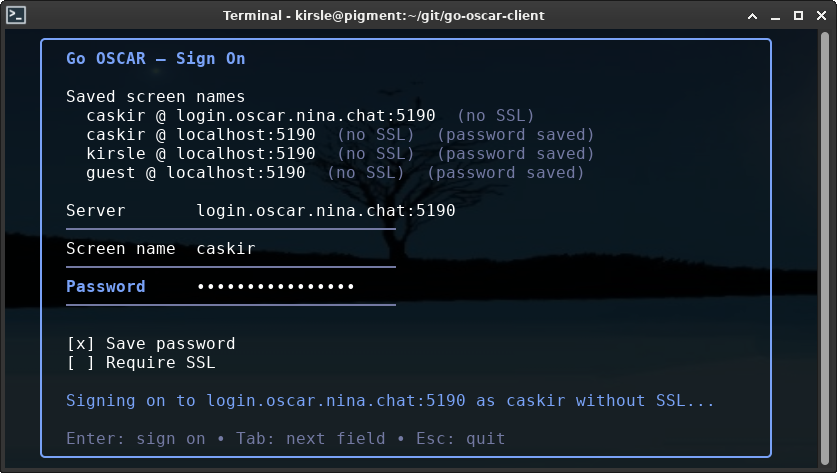
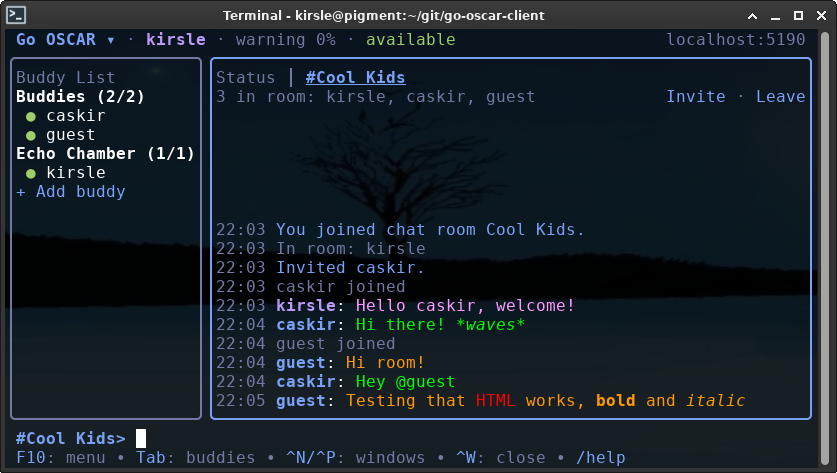
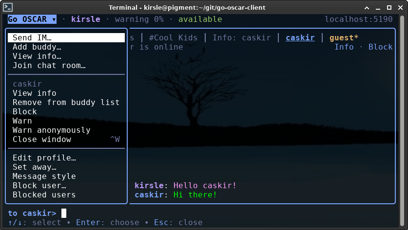
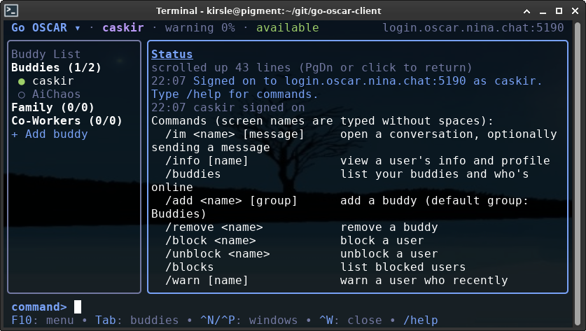

# Go OSCAR Client

An OSCAR (AOL Instant Messenger) client written in Go: a reusable client
library and an interactive terminal client built on it.

It speaks the OSCAR protocol used by classic AIM clients and is developed
against [Open OSCAR Server](https://github.com/mk6i/open-oscar-server), whose
`wire` package it uses for OSCAR wire formats. It also follows the sign-on
handshake of real AIM 5.x clients, so it should work with other OSCAR servers
too.

It has also been tested to work on the [NINA.chat OSCAR server](https://nina.chat).

## Screenshots

This project includes a terminal TUI client program for OSCAR.

The login screen allows you to set the server, screen name and password, which
can optionally be remembered, and your settings are saved to disk with servers
and screen names remembered.



HTML formatting for messages and profile pages works by translating the HTML
tags into ANSI codes. It is possible to manually write HTML in your messages,
or use the `/font` command to set your persistent font styles. Sequences that
are not valid HTML within the subset of tags supported by AIM will be sent
escaped, so sequences like `<3` still send correctly as part of your message.



The main menu with contextual options:



The status screen and /help command:



## Disclaimer: This project is written using A.I.

This codebase was originally developed inside a fork of open-oscar-server for
compatibility with that project's codebase, and this code is 100% vibe coded
using Claude Code.

I am [@Kirsle on GitHub](https://github.com/kirsle) and I generated
this code to scratch my own itch, which is to support building a modern AIM
chatbot written in Go. I have a long history in the instant messenger chatbot
space, having authored many chatbots that ran on AOL Instant Messenger as well as
MSN and Yahoo! Messengers in the early 2000's, and I also created the chatbot
scripting language [RiveScript](https://www.rivescript.com) to drive those bots.

In 2026, there was not an existing OSCAR client module for Go but there were
open source OSCAR servers written in Go which provided the base inspiration for
this project.

OSCAR is a very old and outdated protocol -- AOL Instant Messenger shut down
their servers for good in 2017, and the underlying protocol is insecure by modern
standards, using MD5 hashing as part of the authentication workflow. I did not
want to learn all of the ins and outs of the OSCAR protocol and write this
library the hard way, so I vibe coded the initial version with Claude Code.

**Under Active Maintenance:** After the initial vibe coded base, I have been
fixing bugs and adding features, such as SSL support and making the terminal
UI responsive to very small windows, and mouse support. These updates are
also largely written by A.I. but overseen by me for correctness and design.
This is how we software engineers work nowadays at our day job.

I don't normally use A.I. in my personal projects because I still love the art
of code, but again, OSCAR was low on my list of things to learn about when my
main goal is to write a chatbot. Having classic AIM supported for that bot
would be fun to have.

If you do not want to use an A.I. generated project, then do not use this one.
If you have an interest in OSCAR clients, it would be greatly appreciated if
you could contribute one to the [Open OSCAR Server](https://github.com/mk6i/open-oscar-server)
and then I could label this repository as obsolete in favor of an upstream
client library that could be used instead.

## Terminal client

```sh
go run github.com/kirsle/go-oscar-client/cmd/tui_client@latest
# or, from a checkout:
go run ./cmd/tui_client
```

Run with no flags to get a sign-on screen. Fill in the server, screen name and
password, or pick a saved screen name. To sign on straight away, pass all three
on the command line:

```sh
go run ./cmd/tui_client -server aim.example.com:5193 -screenname alice -password secret
```

SSL is required by default: "Require SSL" is ticked on the sign-on screen, so
use the server's SSL port (5193 for Open OSCAR Server behind its nginx SSL
terminator). If the server's certificate is signed by its own CA, pass that CA
with `-cafile`:

```sh
go run ./cmd/tui_client -server aim.example.com:5193 -cafile ca.crt
```

To sign on to a server without SSL, untick "Require SSL" or pass `-ssl=false`:

```sh
go run ./cmd/tui_client -ssl=false -server 127.0.0.1:5190
```

| Flag          | Description                                                           |
|---------------|-----------------------------------------------------------------------|
| `-server`     | OSCAR server address (`host:port`), default `127.0.0.1:5190`          |
| `-screenname` | Screen name to sign on with                                           |
| `-password`   | Password to sign on with                                              |
| `-ssl`        | Require SSL, default `true`; `-ssl=false` signs on in plaintext        |
| `-cafile`     | PEM file of extra CA certificates to trust, e.g. a server's own CA    |
| `-insecure`   | Skip verifying the server's SSL certificate                           |
| `-config`     | Config file path, default `<user config dir>/go-oscar-tui/config.json` |
| `-plain`      | Strip HTML from messages instead of rendering it with terminal colors |
| `-mouse`      | Make tabs and buddies clickable (default); `-mouse=false` to disable  |
| `-log`        | Write debug logs, including every SNAC sent and received, to a file    |

### Features

- SSL connections, with certificate verification
- Buddy list with groups, online/away/idle status and warning levels
- Instant messages, with automatic replies while you're away
- Chat rooms: join or create, invite, accept invitations, list users
- View anyone's profile and away message; edit your own profile with a live
  preview
- Block and unblock users; warn users, normally or anonymously
- HTML in messages and profiles rendered as terminal colors and styles
- Write formatting HTML such as `<b>`, `<i>`, `<font color="red">` and
  `<a href="...">` straight into your messages; anything else, like `<3`, is
  sent as typed
- A personal font style (color, background, face, size, bold, italic,
  underline) applied to every message you send

### Keys and commands

| Key                       | Action                                    |
|---------------------------|-------------------------------------------|
| `Tab`                     | Switch between the buddy list and input   |
| `Ctrl+N` / `Ctrl+P`       | Next / previous window                    |
| `Ctrl+W`                  | Close the current window                  |
| `PgUp` / `PgDn`           | Scroll the current window                 |
| `Ctrl+C`                  | Sign off and quit                         |

In the buddy list, `Enter` opens an IM, `i` shows info, `w`/`W` warns
(normally/anonymously), `b` blocks or unblocks, and `d` removes a buddy.

The mouse works too: click a window's tab to switch to it, click a buddy to
select them and click again to open an IM, and scroll with the wheel. While
the client has the mouse, most terminals need `Shift` held to select text;
run with `-mouse=false` to leave the mouse to the terminal.

Type `/help` for every command. The main ones:

```
/im <name> [message]     /info [name]        /add <name> [group]   /remove <name>
/block <name>            /unblock <name>     /blocks               /warn [name]
/away [message]          /back               /profile              /font
/join <room>             /invite <name>      /accept               /leave
/buddies                 /windows            /win <number|name>    /next  /prev
/signoff                 /quit
```

### Small terminals

The screen adapts to the terminal size, down to 16 columns by 2 rows. As the
terminal shrinks, the buddy list narrows and then is hidden (`Tab` shows it in
place of the conversation), timestamps, pane borders, the header and the key
help are dropped, window tabs collapse to the active window, and labels are
abbreviated. At the smallest sizes, all that's left is the latest line of
the current window over the input line; `/buddies`, `/windows` and `/win`
stand in for the hidden parts. The sign-on screen likewise drops its box and
scrolls to the focused field.

`/font` shows your message style. `/font help` lists the options, for example
`/font color blue`, `/font bold`, `/font face Comic Sans MS`, `/font reset`.

### Config file

The client remembers each server and screen name you sign on with. For each
account it saves whether SSL is required, your profile, last away message
and font style, plus your password if you tick "Save password". The file is only readable by you, but a
saved password is stored in plain text.

## Library

```go
import "github.com/kirsle/go-oscar-client/client"

c, err := client.Dial(ctx, client.Config{
	Server:     "127.0.0.1:5190",
	ScreenName: "alice",
	Password:   "secret",
})
if err != nil {
	log.Fatal(err)
}
defer c.Close()

if err := c.SendIM(ctx, "bob", "hello <b>bob</b>"); err != nil {
	log.Print(err) // e.g. the user is offline
}

for ev := range c.Events() {
	switch ev := ev.(type) {
	case client.IMEvent:
		fmt.Printf("%s: %s\n", ev.From.ScreenName, ev.Message)
	case client.DisconnectedEvent:
		log.Fatal(ev.Err)
	}
}
```

The `Client` handles sign-on with MD5 (BUCP) authentication, keeps the
server-stored buddy list (feedbag) in sync, and reports activity as events:
buddies arriving and leaving, IMs, warnings, chat invitations and messages, and
disconnects. Its methods cover IMs, profiles, away messages, buddy list and
block list changes, warnings and chat rooms; see the package documentation.

### SSL

Set `SSL` to connect with TLS. The server at `Server` must accept TLS
connections, such as Open OSCAR Server's SSL port. The client follows the SSL
state the server reports for the BOS and chat connections it refers the client
to. It never falls back to plaintext: if the server says a service doesn't use
SSL, `Dial` or `JoinChat` fails with `client.ErrSSLUnavailable`. Connecting
with SSL to a plaintext port fails with `client.ErrNotTLS`.

The server certificate is checked against the system roots. To trust a
server's own CA, set `TLSConfig`:

```go
pool := x509.NewCertPool()
pool.AppendCertsFromPEM(caPEM)

c, err := client.Dial(ctx, client.Config{
	Server:     "aim.example.com:5193",
	ScreenName: "alice",
	Password:   "secret",
	SSL:        true,
	TLSConfig:  &tls.Config{RootCAs: pool},
})
```

`client/htmlterm` converts the HTML in AIM messages and profiles to ANSI-styled
or plain text for terminals.

## Development

```sh
go build ./...
go test -race ./...
gofmt -s -l . && go vet ./...
```

To test against a local server, run
[Open OSCAR Server](https://github.com/mk6i/open-oscar-server) and point the
client at `127.0.0.1:5190`.

## License

MIT License. See [LICENSE](LICENSE) for details.
